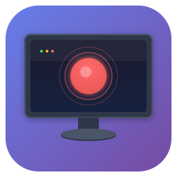

<p align="center">
  
</p>

<h1 align="center">ScreenRecorder</h1>

<p align="center">
  A simple, elegant desktop screen recording application built with Electron
</p>

<p align="center">
  <a href="https://github.com/belinda-hagen/ScreenRecorder/releases/latest">
    
  </a>
  
  
  
  <a href="https://github.com/belinda-hagen/ScreenRecorder/releases">
    
  </a>
</p>


---

## Features

- Record your entire screen or specific windows
- **Record a selected region** - draw a rectangle to record only that area
- Capture system audio and microphone input
- Live preview while recording
- Pause and resume recordings
- **Multiple export formats**: WebM (native), MP4, MKV, MOV, AVI
- Professional dark interface with a dedicated preview, organized settings, and clear recording controls

## Download

Download the latest release from the [Releases](https://github.com/belinda-hagen/ScreenRecorder/releases) page.

**Available for:**

- **Windows**: `.exe` portable version, no installation needed
- **Linux**: `.AppImage`. Make it executable first with `chmod +x ScreenRecorder-*.AppImage`

> **Note**: macOS users can build from source (see Development section below).

## Development

### Prerequisites

- Node.js (v20 or higher)
- npm

### Setup

1. Clone the repository:

```bash
git clone https://github.com/belinda-hagen/ScreenRecorder.git
cd ScreenRecorder
```

2. Install dependencies:

```bash
npm install
```

3. Run the application:

```bash
npm start
```

### Building

To create distributable packages for your current platform:

```bash
npm run build
```

To build for a specific platform:

```bash
# Windows
npm run build:win

# macOS
npm run build:mac

# Linux
npm run build:linux
```

Built files will be in the `dist` folder.

> **Note**: Cross-platform building has limitations. Building macOS apps requires a Mac. Windows and Linux can often be cross-compiled, but native builds are recommended.

## Usage

1. Pick a source under **Source**: a full screen, a window, or a selected area
2. Choose your **Audio inputs** (system audio and/or microphone)
3. Pick an **Output format**
4. Click **Start Recording**. The preview and elapsed time show what's being captured
5. Use **Pause** to pause and resume, then **Stop** to finish and save your recording

## Tech Stack

- **Electron** - Cross-platform desktop apps
- **HTML/CSS/JavaScript** - Frontend
- **MediaRecorder API** - Screen capture
- **FFmpeg** - Converting to MP4, MKV, MOV and AVI

## License

MIT License - feel free to use this project for personal or commercial purposes.
